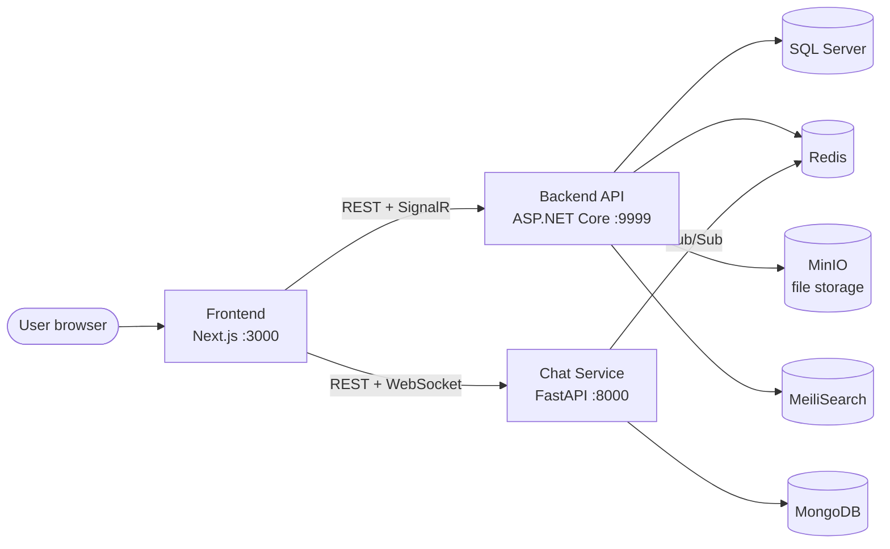

# Petopia — Online Pet Adoption Platform

Petopia is a social platform for pet adoption. It connects pet owners with adopters and gives pet lovers a place to meet. It started as a capstone project.

This repository brings the whole system together in one place. Each service is still developed in its own repository, and is included here as a [git submodule](https://git-scm.com/book/en/v2/Git-Tools-Submodules).

| Folder | Service | Stack | Repository |
| --- | --- | --- | --- |
| [`frontend/`](frontend) | Web app | Next.js 13 · TypeScript · Tailwind CSS | [Petopia-Frontend](https://github.com/Aaron-24DucAnh24/Petopia-Frontend) |
| [`backend/`](backend) | REST API + real-time hub | ASP.NET Core 8 · EF Core · SQL Server | [Petopia-Backend](https://github.com/Aaron-24DucAnh24/Petopia-Backend) |
| [`chat/`](chat) | Chat microservice | FastAPI · MongoDB · WebSocket | [Petopia-Chat](https://github.com/Aaron-24DucAnh24/Petopia-Chat) |

## Architecture



- The **Backend** handles authentication, pets, adoption, blogs and payments. It issues JWT access tokens and sends real-time notifications through a SignalR hub (`/hubs/realtime`).
- The **Chat Service** runs on its own, but accepts the same JWT tokens (shared HS256 secret), so users don't log in twice. It uses the Backend's Redis instance for Pub/Sub.
- The **Frontend** talks to both services: `NEXT_PUBLIC_API_ENDPOINT` for the Backend and `NEXT_PUBLIC_CHAT_API_ENDPOINT` for Chat.

## Getting the code

```bash
git clone --recurse-submodules https://github.com/Aaron-24DucAnh24/Petopia.git
cd Petopia
```

If you already cloned without submodules:

```bash
git submodule update --init --recursive
```

## Running locally

Start the services in this order. Each service's README has the full setup steps.

1. **Backend**: [backend/README.md](backend/README.md)
   ```bash
   cd backend
   docker-compose up -d            # SQL Server, Redis, MinIO, MeiliSearch
   cd Petopia.Data && dotnet ef database update && cd ..
   cd Petopia.API && dotnet run -e ASPNETCORE_ENVIRONMENT=Development
   ```
2. **Chat Service**: [chat/README.md](chat/README.md). Set `JWT_SECRET` to the Backend's `Token:AccessTokenKey`, and point `REDIS_URL` at the Backend's Redis.
   ```bash
   cd chat
   make install && make docker-up && make dev
   ```
3. **Frontend**: [frontend/README.md](frontend/README.md)
   ```bash
   cd frontend
   npm install && npm run dev
   ```

| Service | URL |
| --- | --- |
| Web app | http://localhost:3000 |
| Backend Swagger | http://127.0.0.1:9999/swagger/index.html |
| Chat Swagger | http://localhost:8000/docs |
| MinIO console | http://127.0.0.1:9001/browser |
| MeiliSearch | http://127.0.0.1:7700 |

## Working with submodules

Each submodule is pinned to a specific commit. To move all of them to the latest `main`:

```bash
git submodule update --remote --merge
git add backend frontend chat
git commit -m "chore: bump submodules"
```

Make code changes inside the submodule folder and push them to that service's own repository. Then commit the updated submodule pointer here.
